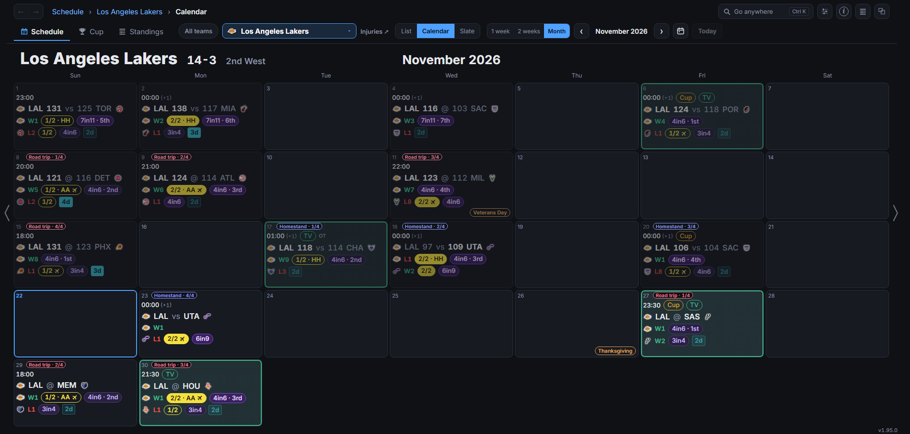
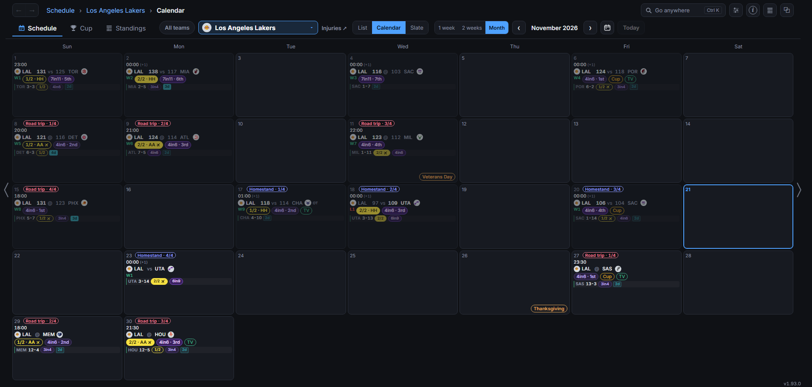
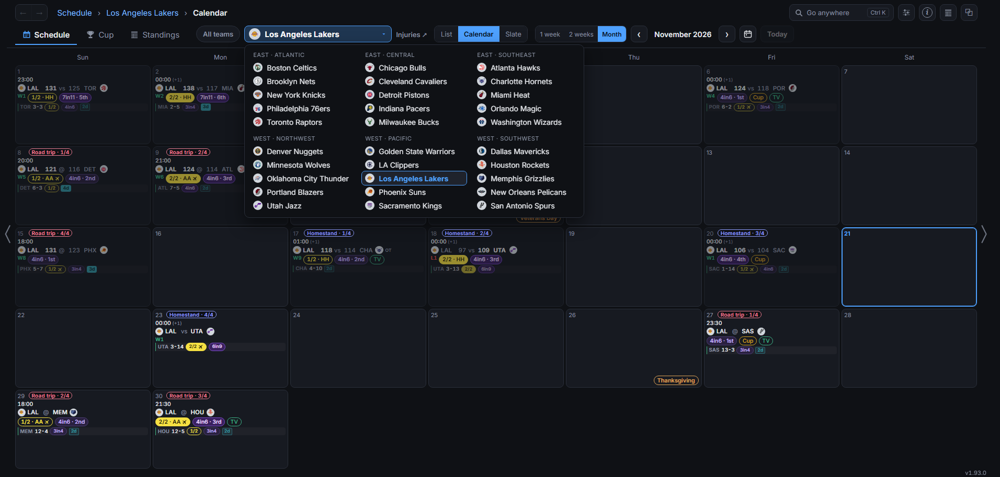
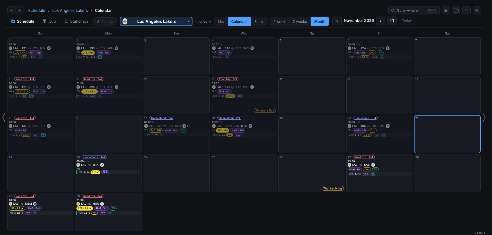
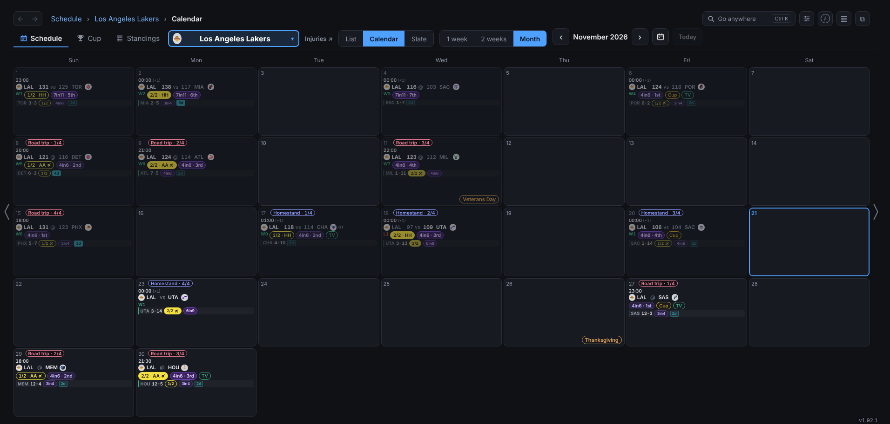
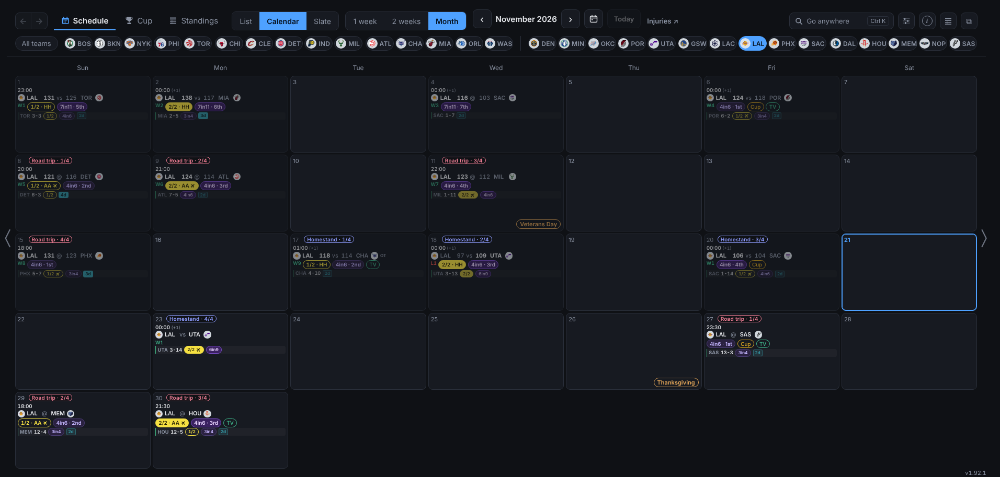
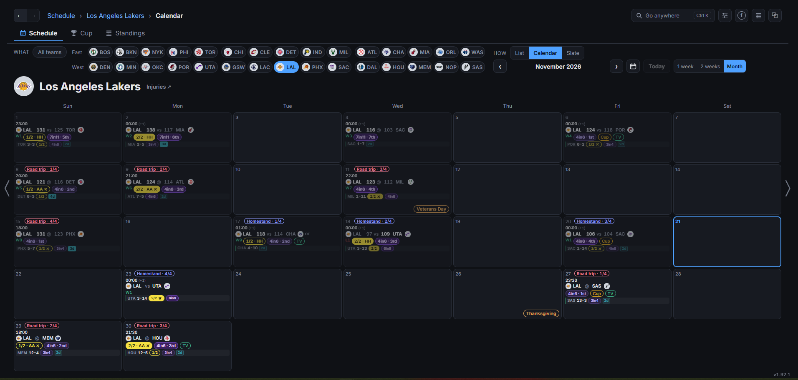
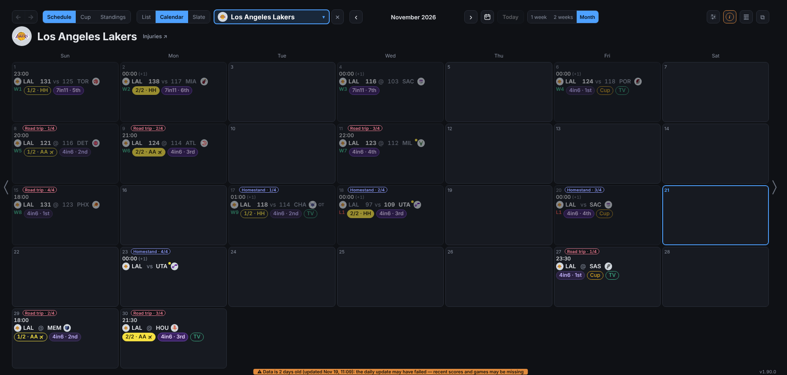
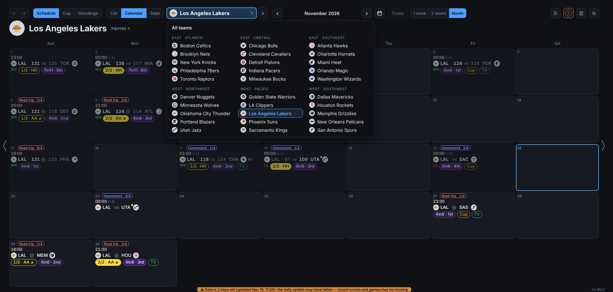

# Design log — calendarkit

Every layout change and every mock, newest first, so old designs can be pulled up later.

Rules:
- One entry per shipped layout change and per mock shown to the owner. Status is one of: shipped, replaced, rejected, picked, pending.
- Every screenshot is the same page at the same window: Lakers, Calendar, Month, November 2026, 1912×913, dark. File name: `shots/<date>-<version or mock letter>-<few words>.png`.
- Every entry gives the three numbers: header height, where the calendar starts (px from the top of the page), day-box height.
- Any shipped version can be rebuilt from git (check out the version's commit, `npm ci`, `npx vite`) to take a new screenshot. Mocks exist only as the pictures here.
- Owner's standing rules (2026-11-21): nothing crosses the header line; the header line never moves down (92px is the most it can be); no always-on-screen team chips.

## 2026-11-22 — v1.96.0 (CK-38 … CK-42): team month redesign — shipped

Header 92px · calendar starts 98px (its own line; the weekday names at 147px) · day box 142px. A line above the grid (team name 34px, record 24px, place 18px, the month 26px centred; all four clickable), four-line game cells (time + Cup / TV chips, one-line matchup, a logo line per team), TV cells with the Slate's green outline and tint, logos without the white disc (light outline), "Fatigue info" in Options. Designed live by the owner in his browser: `docs/mocks/ck-38-team-month-fatigue-off.jpg`, `docs/mocks/ck-39-cells-fatigue-on-closeup.png`.

## 2026-11-21 — v1.93.0 (CK-33): picker + "All teams" button, every control in the tabs row — shipped

Header 92px · calendar starts 98px · day box 151px. Built from mock C, with one difference: the page has no empty 16px above the header any more (the header starts at the window's top edge), which is where the extra box height comes from. Breadcrumb row unchanged; the tabs row holds All teams, the team box, Injuries, List / Calendar / Slate, 1 week / 2 weeks / Month, then the month arrows with a fixed-width month name, the date picker and Today. No chips, no title row, no page scroll; about 350px spare in the tabs row. The same row on every page (Cup, Standings and their sub-pages; 1280px-wide windows use short labels and the team's tricode). The box's panel is the v1.90.0 one without its "All teams" entry.

## 2026-11-21 — Mock C: picker + "All teams" button — picked (CK-33)

Header 92px · calendar starts 118px · day box 147px. Breadcrumb row unchanged; tabs row holds All teams, picker, Injuries, views, span, dates. No chips, no title row. About 250px spare in the tabs row.

## 2026-11-21 — Mock B: picker in the header — replaced by mock C

Header 92px · calendar starts 118px · day box 147px. Same as C without the "All teams" button (it was inside the picker's panel).

## 2026-11-21 — Mock A: chips on one line inside the header — rejected

Header 92px · calendar starts 118px · day box 147px. Row 1 held tabs and all controls (no breadcrumb), row 2 the 30 chips at 54px each with zero spare width. Rejected: the owner decided against always-on-screen chips.

## 2026-11-20 — v1.91.0–v1.92.1 (CK-25): pinned header, chips under the line — replaced by CK-33 (v1.93.0)

Header 92px · calendar starts about 245px · day box about 120px (read off the owner's screenshot). Breadcrumb row + tabs row, then two lines of chips with How and the dates beside them, then the team title row.

## 2026-11-06 to 2026-11-20 — v1.58.0–v1.90.0: one-row menu with team picker — replaced by CK-25

Menu about 44px (one row, ends about 60px from the top) · calendar starts about 125px · day box about 145px. No breadcrumb, no Go anywhere. The picker's panel (six divisions in three columns) is the one CK-33 brings back.
